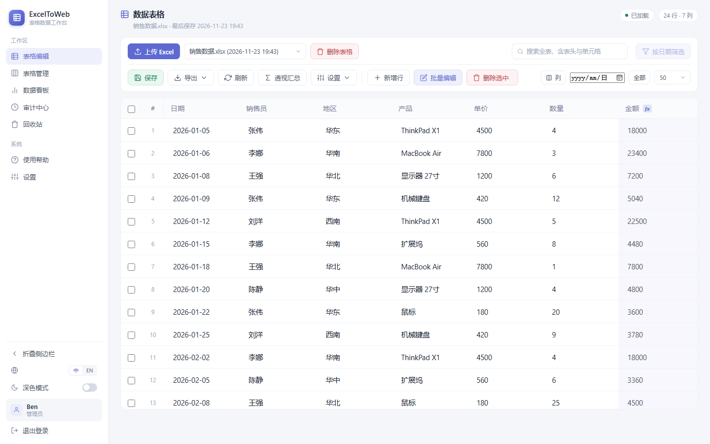
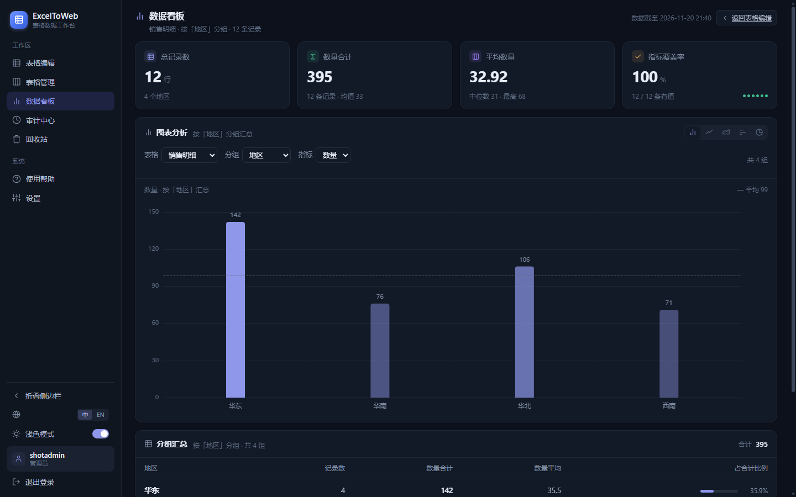
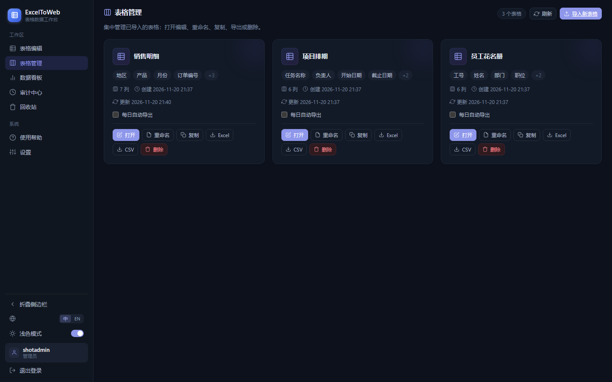
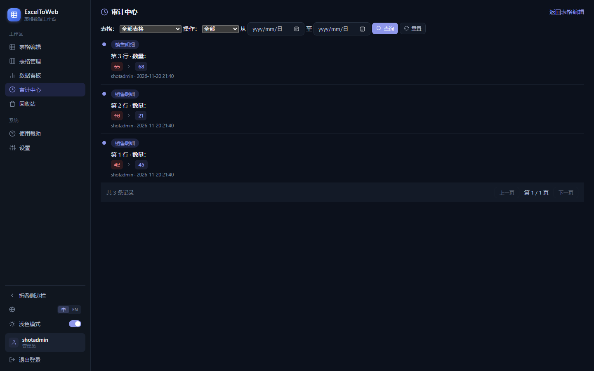
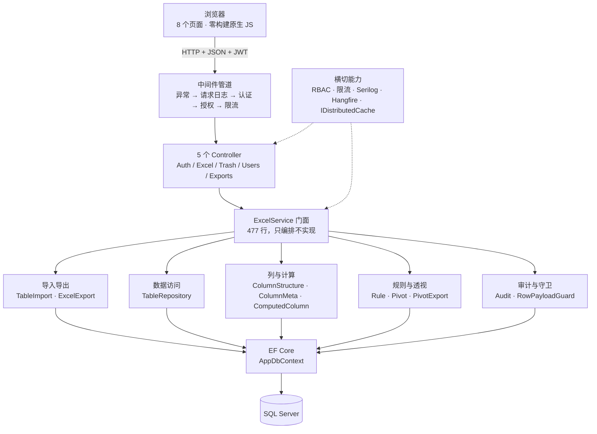
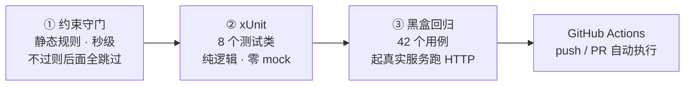

# ExcelToWeb

[](https://github.com/zhenghongxuan2005/ExcelToWeb/actions)
[](https://codespaces.new/zhenghongxuan2005/ExcelToWeb)

把 Excel 表格搬到浏览器里：上传 `.xlsx` / `.csv` 自动建表，在线编辑、规则校验、条件配色，再导出回 Excel —— 一套完整的「Excel → Web」轻量数据工具。

后端 ASP.NET Core Web API + EF Core + SQL Server，前端零构建原生 HTML/CSS/JavaScript（唯一外部运行时依赖是看板按需从 CDN 加载的 ECharts），静态文件由后端直接托管，一条命令即可跑起来。

<p align="center">
  
  
</p>
<p align="center">
  
  
</p>

---

## 本地部署（约 15 分钟）

**先装两个软件**（都免费）：[.NET SDK 10.0](https://dotnet.microsoft.com/download/dotnet/10.0)、
[SQL Server Express 2022](https://www.microsoft.com/sql-server/sql-server-downloads)。
不想装 SQL Server 的话，Visual Studio 自带的 LocalDB 也能用。

```bash
git clone https://github.com/zhenghongxuan2005/ExcelToWeb.git
cd ExcelToWeb
```

**1. 改数据库连接串** —— 编辑 `ExcelToWeb/appsettings.json`，把 `Server=` 换成你自己的实例名：

| 你的环境 | 写法 |
| --- | --- |
| SQL Server Express 默认实例 | `Server=localhost\\SQLEXPRESS` |
| Visual Studio 自带的 LocalDB | `Server=(localdb)\\MSSQLLocalDB` |
| 本仓库开发机的配置 | `Server=localhost\\SQLEXPRESS01` |

`Database=ExcelToWebDB` 不用改，首次启动会自动建库建表。整行长这样（注意 JSON 里反斜杠要写两个）：

```json
"DefaultConnection": "Server=localhost\\SQLEXPRESS;Database=ExcelToWebDB;Trusted_Connection=True;TrustServerCertificate=True;"
```

**2. 配 JWT 密钥**（不写在代码里，存本机用户目录）：

```bash
dotnet user-secrets set "Jwt:Key" "<48 位以上的随机串>" --project ExcelToWeb
```

**3. 运行**：

```bash
dotnet run --project ExcelToWeb
```

看到 `Now listening on: http://localhost:5185` 就成了。首次启动会自动应用迁移、建库、灌演示数据，
之后启动只要几秒。

**4. 打开** <http://localhost:5185> —— 点「一键体验演示账号」看只读样例表，或点「立即注册」建自己的
账号（默认管理员，功能全开）。

> **卡住了？** [docs/LOCAL-SETUP.md](docs/LOCAL-SETUP.md) 有每一步的预期输出和 6 条常见报错的解法。
> **不想装 SQL Server？** 装了 Docker Desktop 就能一条命令起完整环境：`docker compose up -d --build`，
> 详见 [docs/DEPLOY.md](docs/DEPLOY.md)。

## 功能亮点

### 表格
- **导入**：Excel 与 CSV 共用同一条链路 —— 编码自动识别（UTF-8 BOM → 严格 UTF-8 → GBK，中文 Excel 导出的 CSV 直接可用）、分隔符按首行检测、日期从 Excel 序列号转 `yyyy-MM-dd`、合并单元格铺平入库并在导出时还原
- **编辑**：单元格编辑、区域拖选与粘贴、填充柄（复制或等差数列）、查找替换、撤销重做。搜索 / 排序 / 分页只做显示层裁剪，不改写底层数据，编辑始终作用于真实行

### 计算与规则
- **计算列**：在列上写受限表达式（`[单价] * [数量]`、`IF([数量] > 10, "大单", "小单")`），值不落库、每次读取实时计算，因此不会出现「算好的值与源数据对不上」
- **规则引擎**：条件配色（列名 + 数值区间 → 颜色）、数据校验（必填 / 类型 / 区间 / 长度 / 枚举），带校验导入逐行返回「第 N 行：具体原因」

### 认证与权限
- **JWT**：密码经 PBKDF2-SHA256（10 万次迭代）加盐存储；刷新令牌 7 天有效、落库可吊销，被吊销的令牌若被重放则整族失效
- **Windows 集成认证**：内网域环境免密登录，**白名单准入**（只有预置的账号能进，名单外返回 401）。公网环境登录页会自动标注「需内网」并说明原因
- **三角色**：Viewer / Editor / Admin。权限每次请求读库、不认令牌快照，改角色立即生效，对方无需重新登录

### 数据看板
- **自动识别维度与指标**：按列内容判断哪些可分组（上限 50 组）、哪些可聚合，识别不出就明确落到空状态，而不是硬画一张空图
- **图表自适应**：柱状 / 折线 / 面积 / 水平条形 / 环形五种可切；极值悬殊时（最大 / 最小 ≥ 20 倍）出现对数轴开关，含 0 或负值时禁用并说明原因

### 工程与运维
- **整表保存只发两条语句**：`ExecuteDelete` 删全部 + 复用导入路径的原生批量插入（每批 500 行，避开 SQL Server 2100 参数上限），替代「读实体 → RemoveRange → AddRange」生成的 2N 条语句
- **`DynamicRows` 按 `(TableId, Id)` 聚集**：这张表的主路径永远是「按表取整表」（查询 / 导出 / 透视 / 保存），聚集索引让这些操作都不回表
- **开启 RCSI**：读已提交快照隔离，避免整表保存期间针对该表的读请求排队等锁
- **可观测**：Serilog 结构化日志（导入耗时、保存耗时、限流拒绝、并发冲突均有埋点）、`/health` 与 `/health/ready`、审计中心记录每次变更的 diff、回收站保留 30 天

> 完整清单（50+ 条交互细节、性能取舍与边界处理）见 [docs/FEATURES.md](docs/FEATURES.md)。

## 技术栈

| 层次 | 选型 |
| --- | --- |
| 运行时 | .NET 10.0 (`net10.0`)，`Nullable` / `ImplicitUsings` 开启 |
| Web 框架 | ASP.NET Core Web API（Controller 模式） |
| ORM / 迁移 | Entity Framework Core 10.0.10（SqlServer Provider + Migrations） |
| 数据库 | SQL Server（`Microsoft.Data.SqlClient`） |
| 认证 | `Microsoft.AspNetCore.Authentication.JwtBearer` + `Negotiate` |
| 限流 | 内置 `Microsoft.AspNetCore.RateLimiting`（固定窗口 + 按 IP 分区） |
| Excel 读写 | EPPlus 8.7.0（原生 `net10.0` 目标框架），`ExcelPackage.License.SetNonCommercialPersonal(...)` 声明非商业用途 |
| 日志 | Serilog.AspNetCore 10.0.0（控制台 + 按天滚动 JSON 文件） |
| 后台任务 | Hangfire 1.8.25（`Hangfire.AspNetCore` + `Hangfire.SqlServer`，SQL Server 存储） |
| 缓存 | `Microsoft.Extensions.Caching.StackExchangeRedis` 10.0.14 / 内置 `AddDistributedMemoryCache`，按配置切换 |
| API 文档 | Swashbuckle.AspNetCore 7.2.0（Swagger UI，仅开发环境启用） |
| 前端 | 原生 HTML / CSS / JavaScript，无构建步骤；图表用 ECharts 5.5.1（CDN，jsDelivr 失败自动切 npmmirror） |
| 测试 | xUnit（单元）+ Python / Node 脚本（黑盒回归） |

---

## 架构

分层的核心约束只有一条：**Controller 不写业务，门面不写实现**。`ExcelService` 是唯一的编排入口，它注入 10 个各自只管一件事的协作者；任何业务改动都不需要动 Controller。



几处刻意为之的设计：

- **前端零构建**：8 个 HTML 页面 + 54 个原生 JS 模块，由后端 `UseStaticFiles` 托管。代价是脚本加载顺序要手工维护（`index.html` 里的 `<script>` 顺序就是依赖图），收益是没有构建链、改完刷新就生效
- **门面只编排**：`ExcelService` 没有任何 `if` 业务分支，它只负责「先守门 → 再算 → 再落库 → 再记审计」的顺序。顺序本身就是业务（例如 `Validate → Strip → Restore → RemoveRowId` 不能颠倒）
- **横切能力不进业务代码**：权限、限流、日志、后台任务全部在管道或特性上，协作者感知不到它们的存在

---

## 测试

三道关，从最便宜的静态检查开始，前一道不过就不必跑后一道：



测试分两层，各守各的：

| 层 | 位置 | 守什么 | 怎么跑 |
| --- | --- | --- | --- |
| **单元测试**（xUnit） | `ExcelToWeb.Tests/` | 纯逻辑类：公式引擎（词法/语法/求值）、数值/日期口径、密码哈希、JWT 签发、行校验、透视聚合 | `dotnet test` |
| **黑盒回归**（Python + Node） | `tests/` | 起真实服务后的集成路径：API 行为、导入导出、前端模块接线 | `python tests/run.py` |

- 单元测试全部指向不依赖数据库的纯函数/纯类，零 mock；`FormulaLexer`、`FormulaParser` 是 internal 类，经 `InternalsVisibleTo` 直接测
- 黑盒套件由 `tests/run.py` 一键编排：代码约束守门 → 起服务（5185）→ `backend/*.py` → `frontend/*.js`，当前共 42 个用例文件（不含 `helpers/` 下的桩件）
  - 其中 `backend/perf_test.py` 守数据访问层：整表保存（`ExecuteDelete` + 批量重插）后行数与内容不丢、连续保存不翻倍、回收站行数统计准确，并对「加载 / 保存 / 回收站列表」设了 3~5 秒的量级上限——索引一旦丢失或回收站退回逐表子查询，它会立刻报警
- 前端用例不依赖浏览器：Node `vm` 沙箱 + DOM 桩（`tests/frontend/helpers/dom-harness.js`），直接读 `wwwroot` 源文件，因此改前端必跑
- **约束守门**（`tests/check_constraints.py`，`run.py` 的第 0 项，不过则后面全跳过）：禁 `eval` / `new Function` / `alert` / `document.write`、禁用 `Console.WriteLine` 与空 catch、`index.html` 脚本加载顺序、共享模块装配审计；行数**不再是约束**（`--lines` 只打印体量提示）。规则细节见 [CODE_STANDARDS.md](CODE_STANDARDS.md)
- GitHub Actions（`.github/workflows/ci.yml`）按同样顺序跑全部门禁：`dotnet build ExcelToWeb.slnx` → `dotnet test` → 约束守门 → 黑盒回归（ubuntu runner + SQL Server 容器服务）

> 前置：Python 3.x、Node 20+（仅跑测试需要）。测试固定连 `http://localhost:5185`，可用环境变量 `TEST_BASE_URL` 改端口；`run.py` 用 `dotnet run --no-build`，**改了 C# 要先 `dotnet build`**，否则测的是旧二进制。

---

## 已知限制与安全提醒

**已完成的安全加固：**

- **JWT 密钥已移出仓库**：`appsettings.json` 中已**删除** `Jwt:Key`，本地用用户机密、生产用环境变量注入；生产环境额外拒绝占位串与 < 32 字符的弱密钥。⚠️ 需注意 git **历史**里仍残留一个早期提交的明文旧密钥 —— 该密钥已轮换失效，但若要让仓库历史也干净，需用 `git filter-repo` 或 BFG 重写历史并强推。
- **CORS 已按环境区分**：开发环境仍放开（`AllowAnyOrigin`，便于本地调试）；生产环境只放行 `Cors:AllowedOrigins` 中显式配置的来源，未配置即不启用跨域。正式上线前记得填白名单。
- **异常信息已按环境收敛（RFC 7807 ProblemDetails）**：未捕获异常统一返回 `application/problem+json`（含 `traceId` 扩展与 `message` 兼容字段）；生产环境 `detail` 只含追踪号、异常明细仅写服务端日志，开发环境保留明细便于排查。业务 4xx 仍走 `ApiResponse { success, message }` 契约，前端与测试只处理两种明确结构。
- **登录 / 注册已限流**：按来源 IP 固定窗口（默认 10 次 / 分钟），避免撞库与用户枚举。
- **`.gitignore` 已补充** `.workbuddy/` 与 `appsettings.*.local.json`。
- **依赖漏洞已根除**：原先 EPPlus 6.0.3 会传递引入 `System.Drawing.Common` 5.0.0，触发 `NU1904`（GHSA-rxg9-xrhp-64gj / CVE-2021-24112，严重级）。已升级到 **EPPlus 8.7.0**，该版本不再依赖 `System.Drawing.Common`，依赖图中已无易受攻击的包（`dotnet list package --vulnerable --include-transitive` 返回空），构建 0 警告。

**仍需注意：**

- **未设置 CSP 响应头**：目前防 XSS 只有一层 —— 所有动态内容经 `escapeHtml` 转义（`innerHTML` 拼接处一律先转义）。**这是已知待补项**，加 CSP（`default-src 'self'` + 允许 ECharts CDN）应在正式上线前完成。
- **Windows 集成认证**需服务端与客户端处于同一域（或受信任域）才有意义；由 `Auth:EnableWindows` 开关控制（本地开发默认开、生产默认关）。关闭时 `/api/auth/windows` 返回 404，登录页据此在按钮上标注「需内网」并说明原因，而不是给出一个点了没反应的入口。
- **HTTPS**：生产环境已启用 `UseHttpsRedirection()` + `UseHsts()`；本地开发仍走 HTTP（不影响 localhost 调试）。部署到 App Service 时 TLS 在网关层终结，若出现重定向异常，检查平台的 HTTPS 端口 / 转发头配置。
- **JWT 存在 `localStorage`**：实现简单，但页面一旦存在 XSS，Token 就可能被脚本读取。若需要更强保证，建议改为 `HttpOnly` Cookie + CSRF 防护（需同步改刷新令牌的下发与校验路径）。

**架构层面：**

- **EF Migrations 已切换完成**：此前用 `EnsureCreated()` + 手写补表 SQL，现已切换为 baseline 迁移 + 启动自动 `Migrate()`，存量库自动平滑过渡。后续改表结构直接 `dotnet ef migrations add Xxx` 即可，但「启动时自动迁移」在生产多实例下有并发竞争的边界，单实例部署下无碍。
- **保存语义为整表替换**：`/api/excel/save` 会先删除该表所有行再插入，大数据量下有性能开销；已引入 `RowVersion` 乐观并发控制，多标签页/多人并发编辑同一张表时，后保存者会收到「表格已被其他人修改，请刷新后再保存」的提示并回滚，不再静默覆盖。
- **计算列不落库**：值是读取时按公式实时算的，所以不会与源数据不一致；代价是每次查询多一轮求值，且公式只能引用本行已有列（不支持跨行 / 跨表引用，也没有 `SUM` 这类聚合函数，聚合请用透视汇总）。
- **数据存在 JSON blob 中**：不支持 SQL 层的列级索引与聚合查询，所有筛选在应用内存中完成。适合中小规模数据集，**单表建议 ≤ 5 万行**。
- **上传/导入已设资源上限**：文件 ≤ 10MB、单表数据 ≤ 5 万行、列数 ≤ 200 列，超限会在上传阶段直接拒绝并返回明确提示（避免大文件全量进内存拖垮实例）。
- **无构建、无打包的前端**：改完刷新即可生效，但也意味着没有 tree-shaking / 模块隔离，靠 `CODE_STANDARDS.md` 的约束守门兜住「模块装配遗漏」这类问题。

---

## 更多文档

| 文档 | 内容 |
| --- | --- |
| [docs/LOCAL-SETUP.md](docs/LOCAL-SETUP.md) | 本地部署完整教程：每步的预期输出 + 常见报错排查 |
| [docs/DEPLOY.md](docs/DEPLOY.md) | 容器化部署、Codespaces 免费演示、云服务器、内存与镜像拉取的坑 |
| [docs/FEATURES.md](docs/FEATURES.md) | 功能清单详细版（50+ 条） |
| [docs/API.md](docs/API.md) | 全部接口：路径、方法、权限、请求与响应形状 |
| [docs/STRUCTURE.md](docs/STRUCTURE.md) | 目录分工与三类核心表的关系 |
| [docs/CONFIG.md](docs/CONFIG.md) | 所有可配项的默认值、改法与常见问题 |
| [docs/QUERYSPEC.md](docs/QUERYSPEC.md) | 列表查询契约的设计稿：现状盘点、非目标、分期与升级路径 |
| [QA_FINDINGS.md](QA_FINDINGS.md) | 27 条自测记录：发现的问题、根因、修法与教训 |

## 许可

本项目以 **MIT 许可证** 开源，详见 [LICENSE](LICENSE)。

**注意**：MIT 只覆盖本仓库自身的源代码。项目依赖的 **EPPlus 8.x 采用 Polyform Noncommercial 许可证**，非商业使用免费，商业使用需单独获得授权。
